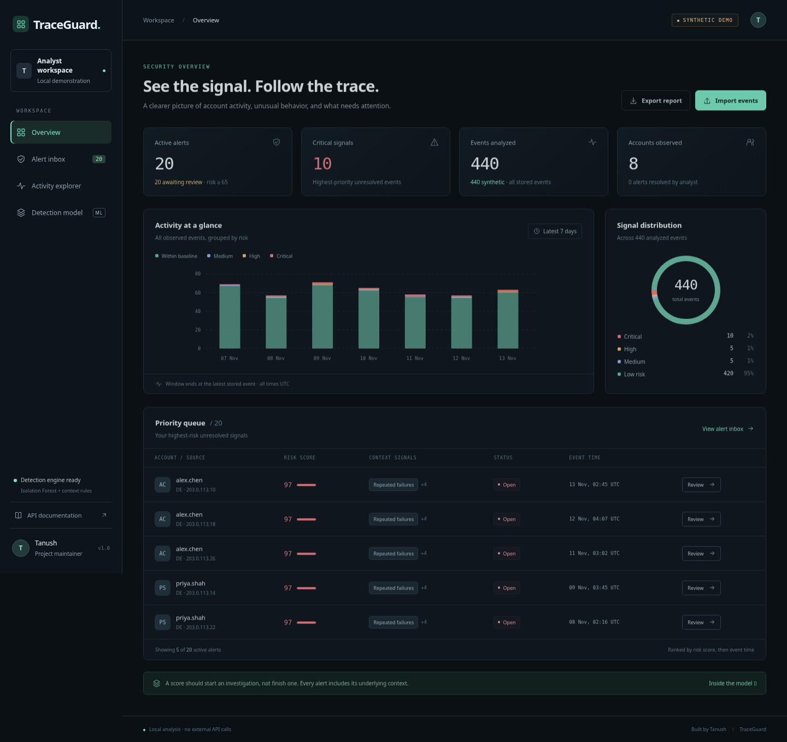

# TraceGuard

### See the signal. Follow the trace.

A local behavioral security analytics application built with **Python, FastAPI, scikit-learn, and SQLite**. Import activity events, rank unusual behavior, inspect contextual signals, and record an investigation from detection to resolution.

Created by [Tanush](https://github.com/tanush78) to connect machine learning experiments with a usable software engineering workflow.



## What you can do

- **Explore a working dashboard:** event-volume charts, risk distribution, active alerts, and account counts reflect the database.
- **Investigate a signal:** inspect account, source IP, device, location, outbound volume, failure count, and triggered rules.
- **Triage with persistence:** move an alert between Open, Investigating, and Resolved; record notes in a timestamped audit trail.
- **Bring CSV activity:** validate typed rows atomically, score events, and skip duplicate events without losing earlier investigation notes.
- **Inspect the detector:** see the model's features, baseline, score formula, contextual thresholds, evaluation, and limitations.
- **Export a report:** download filtered results as CSV with spreadsheet-formula neutralization.
- **Try it without credentials:** 440 fictional demo events are generated on the first run. No paid API or service is required.

The web interface supports small screens, keyboard-accessible dialogs, light motion preferences, search, filters, pagination, and a detailed event inspector. All analysis happens in the Python backend; the interface does not simulate API responses.

## Run locally

Use **Python 3.12**. Python 3.10+ should work with compatible dependency releases, but 3.12 is the tested runtime.

```bash
git clone https://github.com/tanush78/TraceGuard.git
cd TraceGuard
python -m venv .venv
# macOS / Linux
source .venv/bin/activate
# Windows PowerShell: .venv\Scripts\Activate.ps1
python -m pip install -r requirements.txt
python run.py
```

Open **http://127.0.0.1:8000**. API documentation is available at **http://127.0.0.1:8000/docs**.

The first run creates `data/traceguard.db`. Subsequent runs retain imported events and triage history. There is no account signup and no API key.

### Docker alternative

```bash
docker build -t traceguard .
docker run --rm -p 127.0.0.1:8000:8000 -v traceguard-data:/data traceguard
```

The container runs as a non-root user, uses a persistent named volume, and includes a health check. The image was built and smoke-tested separately from the local Python environment; see [verification notes](docs/VERIFICATION.md).

## A two-minute demo

1. Start at **Overview** and open the highest-risk alert in the priority queue.
2. Inspect its context signals and raw telemetry. Notice that the score is a ranking, not an attack probability.
3. Change the status to **Investigating**, add a note, and save the decision.
4. Open **Alert inbox** and filter for Investigating to find it again.
5. Use **Import events → Download the example template**, import the CSV, and inspect the imported event.
6. Import the same file again: it is reported as a duplicate and its existing triage history is preserved.
7. Explore **Detection model** to explain the methodology, then export filtered alerts.

## Detection approach

The model is an **Isolation Forest**, trained on 800 clean synthetic baseline events. An independent set of 240 clean generated events calibrates anomaly percentiles. Six features capture activity volume and context:

1. `log(1 + failure_count)`
2. `log(1 + data_out_mb)`
3. New-device flag
4. Activity outside 08:00–20:00 UTC
5. Country absent from the account's clean training baseline
6. Unknown account flag

The hybrid score is:

```text
risk = round(min(100, 0.35 × anomaly_percentile + min(65, rule_points)))
```

Context rule points are 35 for ≥10 failures, 35 for ≥500 MB outbound, 20 for a new device, 20 for a country absent from a known account's baseline, 15 for an unknown account, and 10 for activity outside the fixed UTC work window. A score ≥65 creates an alert; ≥85 is High and ≥95 is Critical.

Context signals explain **which rules fired**. They are not SHAP values, causal explanations, or per-feature attribution for the Isolation Forest. The score is not a calibrated probability of malicious activity.

### Reproduce the evaluation

```bash
python scripts/evaluate.py
```

This prints precision, recall, and F1 for a separate set of 240 typical synthetic events, 20 legitimate large-transfer hard negatives, and 40 injected anomalies, evaluated at the alert threshold. The backup-like hard negatives expose false positives: a large transfer is not necessarily malicious. Fixed seeds make the results repeatable within the same dependency versions. The injected scenarios intentionally exaggerate failure counts, transfer volume, and novelty; scores from this controlled demonstration are **not evidence of real-world detection accuracy**.

### Baseline limitations

The prototype uses fictional accounts and a fixed UTC working window. It does not train on imported logs or automatically infer a real organization's habits. New-device flags, country, transfer volume, and observation-window failure counts must come from the source system; no IP geolocation or time-window aggregation is performed here. Unknown accounts lack a personalized baseline and should be reviewed cautiously.

Useful extensions are organization-specific baselines, user-local timezones, temporal aggregation, drift monitoring, validation on a documented real dataset, authentication, and analyst identities. The app currently serves a **single analyst on localhost**, with no authentication or production deployment claims.

## CSV contract

Download an example from `/api/template`. Headers must match exactly, with no extra or duplicate columns:

| Column | Expected value |
| --- | --- |
| `timestamp` | ISO 8601 timestamp with timezone, e.g. `2026-11-14T02:30:00Z` |
| `user` | Nonempty account identifier; letters, numbers, `.`, `_`, `@`, `+`, `-` |
| `source_ip` | Valid IPv4 or IPv6 address |
| `country` | Two uppercase letters supplied by the source |
| `device` | Nonempty device description, up to 100 characters |
| `outcome` | `success` or `failed` |
| `failure_count` | Integer from 0 to 10,000 within a source-defined observation window |
| `data_out_mb` | Finite nonnegative outbound volume, up to 1,000,000 MB |
| `new_device` | Boolean, e.g. `true` / `false` |

UTF-8 CSV imports are limited to 2 MB and 5,000 rows. Every row is validated **before** the transaction writes anything. Invalid files return a row/field error. A canonical event payload is hashed to identify duplicates, independent of CSV row order or file name.

The provided IPs use documentation-only address ranges. Demo account names are fictional. Report CSVs contain additional result columns and are intended for analysis, not direct re-import.

## Architecture

```text
Browser: HTML + CSS + JavaScript
          │ same-origin JSON / CSV
          ▼
FastAPI: validation → feature transforms → anomaly + context scoring
          │                              │
          ▼                              ▼
SQLite: events + triage audit         Model metadata / evaluation
```

```text
app/
├── main.py          # API, atomic CSV ingestion, reports, static serving
├── schemas.py       # Typed event and triage validation
├── detector.py      # Isolation Forest, calibrated score, contextual rules
├── data.py          # Seeded fictional baseline and injected scenarios
├── store.py         # Transactions, deduplication, triage audit persistence
└── static/          # Responsive dashboard and investigation interface
tests/test_api.py    # API, persistence, scoring, validation, export tests
scripts/evaluate.py # Reproducible synthetic evaluation
```

## Tests

```bash
python -m pip install -r requirements-dev.txt
python -m unittest discover -s tests -v
```

The suite covers anomaly ranking, dashboard aggregation, idempotent imports, all-or-nothing validation, invalid schema and size limits, persisted triage history, restart behavior, and spreadsheet-safe exports. UI interactions are exercised separately through browser checks.

### Optional browser checks

The application does not need Node.js, but the browser checks use Node.js 20+ and Playwright:

```bash
npm install
npx playwright install chromium
npm run test:ui
```

The script starts an isolated API on localhost port 8876 with a temporary database, exercises the main workflows on desktop and mobile, saves screenshots in `docs/`, and removes its test database afterward. Set `PLAYWRIGHT_CHROMIUM_PATH` to use an existing compatible browser instead of a downloaded one. Start from the repository root with the Python environment activated.

For a walkthrough of the engineering choices, see [the interview guide](docs/INTERVIEW.md).

## Configuration

These are environment variables, not secrets; `.env.example` is a reference and is not automatically loaded.

| Variable | Default | Purpose |
| --- | --- | --- |
| `TRACEGUARD_DB` | `data/traceguard.db` | SQLite database location |
| `TRACEGUARD_SEED_DEMO` | `true` | Seed fictional events only when the database is empty |
| `HOST` | `127.0.0.1` | Listener interface |
| `PORT` | `8000` | Local listener port |

No paid service, external AI endpoint, or cloud database is used. The interface requests optional Google Fonts; it falls back to installed fonts when offline. Run with demo data or logs you are authorized to analyze. Authentication and network deployment hardening are intentionally outside this local prototype.

## License

MIT. See [LICENSE](LICENSE).
